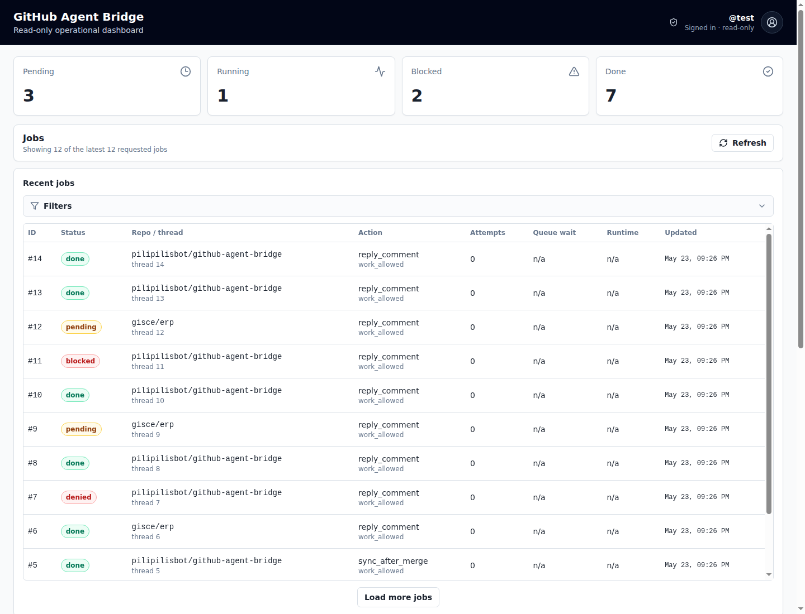
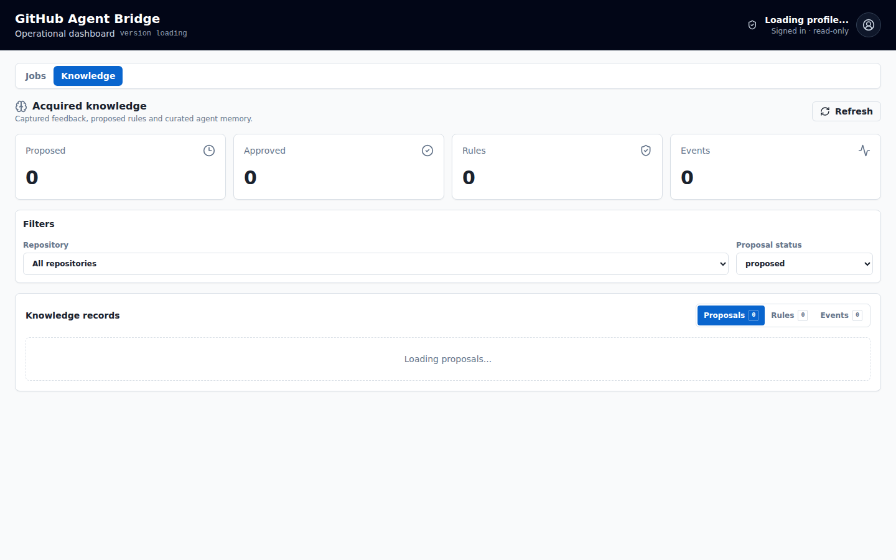
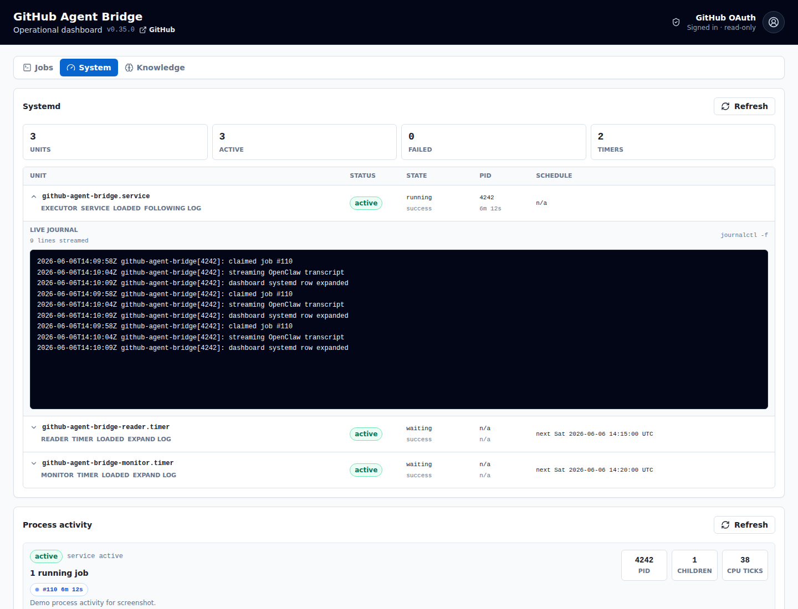
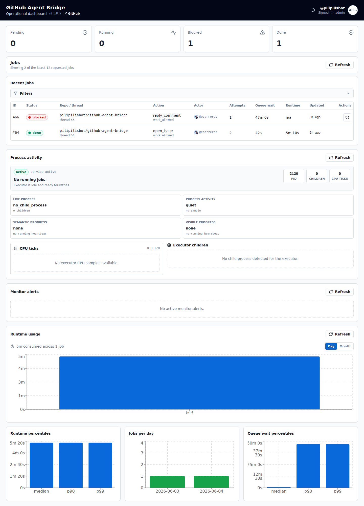

<div class="cover-wrap">
  <div class="signal-line"><span></span><span></span><span></span><span></span></div>
  <h1>GitHub<br><em>Agent Bridge</em></h1>
  <p class="lede">Del “ping” a la feina acabada.<br>Sense perdre control pel camí.</p>
  <div class="cover-meta">
    <span>LIGHTNING TALK · 7 MIN</span>
    <span>github.com/gisce/github-agent-bridge</span>
  </div>
</div>

<!--
- GitHub ja sap quan passa alguna cosa.
- OpenClaw ja sap treballar sobre repositoris.
- El Bridge resol la part difícil: connectar-los de manera durable, segura i observable.
- No és un bot que “escolta comentaris”; és infraestructura de treball agentic.
-->

---
layout: center
class: thesis-slide
---

# Un comentari no és una tasca

<div class="thread-demo">
  <div class="avatar">EC</div>
  <div>
    <strong>@giscebot pots revisar aquesta PR?</strong>
    <p>GitHub entrega un esdeveniment. La feina pot durar minuts, fallar, repetir-se o rebre més context.</p>
  </div>
</div>

<div class="problem-row">
  <div><b>1</b><span>arriba dues vegades</span></div>
  <div><b>2</b><span>dos agents xoquen</span></div>
  <div><b>3</b><span>un restart ho talla</span></div>
  <div><b>4</b><span>ningú sap què ha passat</span></div>
</div>

<!--
- Una menció sembla simple, però el treball real no ho és.
- Webhook i email poden representar el mateix fet.
- Dos comentaris del mateix fil no poden disparar dues branques incompatibles.
- I si el procés cau, la tasca no pot desaparèixer.
- Aquí comença el Bridge.
-->

---
layout: center
class: pipeline-slide
---

# Un pipeline, no màgia

<div class="pipeline">
  <div class="source"><span>GitHub</span><small>webhook signat</small></div>
  <div class="source"><span>Fallback</span><small>IMAP / replay</small></div>
  <div class="arrow">→</div>
  <div class="stage hot"><span>Normalitza</span><small>identitat canònica</small></div>
  <div class="arrow">→</div>
  <div class="stage"><span>Decideix</span><small>policy + intent</small></div>
  <div class="arrow">→</div>
  <div class="stage"><span>Persisteix</span><small>SQLite / WAL</small></div>
  <div class="arrow">→</div>
  <div class="stage end"><span>Executa</span><small>OpenClaw</small></div>
</div>

<div class="invariants">
  <span>durable abans d'ACK</span>
  <span>1 worker per PR/issue</span>
  <span>paral·lel entre fils</span>
  <span>deduplicació cross-source</span>
</div>

<!--
- Totes les entrades acaben en una notificació neutral al transport.
- Abans d'avançar cap cursor, el fet queda persistit.
- La work_key és owner/repo#number: un fil se serialitza, els fils diferents corren en paral·lel.
- Webhook i IMAP poden coexistir sense duplicar feina quan la identitat és demostrable.
-->

---
layout: two-cols-header
class: screenshot-slide
---

# Operació visible

::left::

<div class="big-copy">La cua deixa de ser una caixa negra.</div>

<ul class="feature-list">
  <li><strong>Jobs</strong> i estat en temps real</li>
  <li><strong>Filtres</strong> per repo, acció i resultat</li>
  <li><strong>SLO</strong>, latència i throughput</li>
  <li><strong>Detall</strong> de cada execució</li>
</ul>

<p class="data-note">Captura real del dashboard amb dades operatives de demostració.</p>

::right::



<!--
- El dashboard no és decoració: és el contracte operatiu visible.
- Podem veure què espera, què corre, què s'ha completat i què està bloquejat.
- També podem seguir latència, volum i resultats per repositori.
- Les captures del deck són del producte real, amb dades de demostració.
-->

---
layout: two-cols-header
class: policy-slide
---

# L'agent no decideix els seus permisos

::left::

```json {2-4|5-8|9-15|all}
{
  "trustedOrgs": ["gisce"],
  "enabledRepos": ["gisce/erp"],
  "webhookCanaryRepos": ["gisce/erp"],
  "repoRoles": {
    "gisce/erp": "maintainer"
  },
  "actions": {
    "auto": ["archive_notification"],
    "trustedAuto": [
      "reply_comment",
      "submit_review",
      "workflow_run_failed"
    ]
  }
}
```

::right::

<div class="policy-stack">
  <div><b>Trust</b><span>qui pot activar feina</span></div>
  <div><b>Scope</b><span>on pot actuar</span></div>
  <div><b>Intent</b><span>review o canvi real</span></div>
  <div><b>Role</b><span>amb quin criteri</span></div>
  <div><b>Route</b><span>quin agent i model</span></div>
</div>

<!--
- La política és explícita, versionable i validable amb JSON Schema.
- El rol controla el criteri; la intenció controla les accions.
- “Owner + review_only” vol dir criteri d'owner, però zero canvis al repo.
- També podem rutear per repo, acció o intenció cap a agents i models diferents.
-->

---
layout: two-cols-header
class: screenshot-slide knowledge-slide
---

# Aprèn del feedback

::left::



::right::

<div class="big-copy">Les reviews humanes es converteixen en criteri reutilitzable.</div>

<ul class="feature-list">
  <li>Regles curades per <strong>repo</strong> i <strong>organització</strong></li>
  <li>Confiança i evidència, no memòria difusa</li>
  <li>Consulta read-only via <strong>MCP autenticat</strong></li>
  <li>El proper agent rep el context abans d'actuar</li>
</ul>

<p class="data-note">Captura real de Knowledge amb regles de demostració.</p>

<!--
- El Bridge no només envia feina: pot capturar criteri dels reviews.
- Les regles tenen abast, confiança i evidència.
- Es poden injectar en futurs jobs o consultar des d'altres agents mitjançant MCP read-only.
- Això converteix feedback repetit en coneixement operacional auditable.
-->

---
layout: center
class: modes-slide
---

# Producció sense salt de fe

<div class="rollout">
  <div><b>Replay</b><small>fixtures, zero efectes</small></div>
  <span>→</span>
  <div><b>Shadow</b><small>observa els dos inputs</small></div>
  <span>→</span>
  <div><b>Dry-run</b><small>simula dispatch</small></div>
  <span>→</span>
  <div><b>Canary</b><small>repos seleccionats</small></div>
  <span>→</span>
  <div class="live"><b>Primary</b><small>webhook + fallback</small></div>
</div>

<div class="guardrails">
  <div><span>HMAC</span> webhook signat</div>
  <div><span>fail closed</span> si falta evidència</div>
  <div><span>canary scope</span> hard allowlist</div>
  <div><span>rollback</span> IMAP continua viu</div>
</div>

<!--
- No es passa de local a live amb una bandera i esperança.
- Replay, shadow, dry-run, canary i primary són fases explícites.
- La promoció exigeix finestres d'observació completes i paritat entre transports.
- El fallback IMAP es retira al final, no al principi.
-->

---
layout: two-cols-header
class: evidence-slide
---

# I quan alguna cosa falla?

::left::


<p class="data-note">Logs i estat dels serveis.</p>

::right::


<p class="data-note">Retry administratiu, amb traça.</p>

<div class="ops-strip">
  <span>monitor</span><span>alertes</span><span>retry</span><span>autoupdate</span><span>web push</span>
</div>

<!--
- Un job bloquejat no bloqueja la resta.
- L'error queda persistit i es pot inspeccionar.
- Hi ha monitorització, logs de serveis, retry administratiu i planificació segura d'updates.
- En acabar, el dashboard pot enviar web push a l'actor humà que va originar la feina.
-->

---
layout: center
class: finale-slide
---

<div class="final-mark"><span></span></div>

# GitHub diu <em>què ha passat</em>.<br>El Bridge garanteix <em>què passa després</em>.

<div class="final-grid">
  <span>ingesta dual</span>
  <span>cua durable</span>
  <span>concurrència segura</span>
  <span>policy explícita</span>
  <span>observabilitat</span>
  <span>coneixement MCP</span>
</div>

<p class="repo-link">github.com/gisce/github-agent-bridge</p>

<!--
- El diferencial no és activar un agent des de GitHub.
- És poder fer-ho cada dia, en molts repos, sense duplicats, sense carreres i sabent què ha passat.
- GitHub explica el fet; el Bridge governa la feina que ve després.
-->

<style>
@import url('https://fonts.googleapis.com/css2?family=IBM+Plex+Mono:wght@400;600&family=Inter:wght@400;500;600;700;800&display=swap');

:root { --ink:#0b1020; --paper:#f7f5ef; --lime:#b9f227; --cyan:#6ee7f2; --muted:#667085; --line:#d7d9df; }
.slidev-layout { background:var(--paper); color:var(--ink); font-family:Inter,sans-serif; padding:3.2rem 4rem; }
.slidev-layout h1 { font-size:2.65rem; line-height:1.02; letter-spacing:-.035em; font-weight:800; }
.slidev-layout em { color:#527400; font-style:normal; }
.slidev-layout code { font-family:'IBM Plex Mono',monospace; }
.cover-wrap { height:100%; display:flex; flex-direction:column; justify-content:center; position:relative; }
.cover-wrap h1 { font-size:5.1rem; max-width:750px; margin:0; }
.lede { font-size:1.45rem; line-height:1.35; margin-top:1.4rem; color:#3d465a; }
.signal-line { position:absolute; right:0; top:5%; height:90%; width:32%; display:flex; gap:18px; align-items:center; }
.signal-line span { width:4px; background:var(--ink); border-radius:4px; animation:pulse 2.4s ease-in-out infinite; }
.signal-line span:nth-child(1){height:20%}.signal-line span:nth-child(2){height:70%;background:var(--lime)}.signal-line span:nth-child(3){height:42%}.signal-line span:nth-child(4){height:88%;background:var(--cyan)}
@keyframes pulse { 0%,100%{transform:scaleY(.92)} 50%{transform:scaleY(1.05)} }
.cover-meta { display:flex; justify-content:space-between; border-top:1px solid var(--ink); margin-top:3rem; padding-top:.7rem; font:600 .72rem 'IBM Plex Mono'; letter-spacing:.05em; }
.thread-demo { display:flex; gap:1.1rem; align-items:flex-start; padding:1.35rem 1.5rem; border:1px solid var(--line); border-radius:14px; background:white; width:78%; margin:2rem auto; box-shadow:0 12px 32px rgba(11,16,32,.08); }
.avatar { background:var(--ink); color:white; width:48px; height:48px; border-radius:50%; display:grid; place-items:center; font-weight:700; }
.thread-demo p{margin:.35rem 0 0;color:var(--muted)}
.problem-row { display:grid; grid-template-columns:repeat(4,1fr); gap:1.3rem; margin-top:2.4rem; }
.problem-row div { border-top:3px solid var(--ink); padding-top:.7rem; display:flex; flex-direction:column; }
.problem-row b { font-size:2.2rem; color:#527400; }
.problem-row span { font-size:.85rem; }
.pipeline { display:flex; align-items:center; justify-content:center; gap:.75rem; margin:2.6rem -1.5rem 1.6rem; }
.source,.stage { padding:1rem 1.1rem; border:1px solid var(--ink); border-radius:12px; background:white; min-width:135px; }
.source{background:var(--ink);color:white}.stage.hot{background:var(--cyan)}.stage.end{background:var(--lime)}
.source span,.stage span{display:block;font-weight:800}.source small,.stage small{display:block;margin-top:.25rem;font-size:.65rem;opacity:.7}.arrow{font-size:1.7rem}
.invariants { display:flex; justify-content:center; gap:.7rem; flex-wrap:wrap; }
.invariants span,.final-grid span { padding:.45rem .75rem; border:1px solid var(--ink); border-radius:999px; font:600 .68rem 'IBM Plex Mono'; }
.screenshot-slide { background:var(--ink); color:white; }
.screenshot-slide h1{color:white}.screenshot-slide .slidev-layout{padding-right:2.8rem}.screenshot-slide .big-copy{font-size:1.25rem;line-height:1.35;max-width:360px;color:#d5d9e4;margin:2rem 0}
.feature-list{list-style:none;padding:0;margin:0}.feature-list li{padding:.65rem 0;border-bottom:1px solid rgba(255,255,255,.18);font-size:.9rem}.feature-list li::before{content:'→';color:var(--lime);margin-right:.65rem}
.data-note{font:500 .58rem 'IBM Plex Mono';opacity:.62;margin-top:1rem}
.policy-stack{display:flex;flex-direction:column;gap:.7rem;margin:1rem 0 0 2rem}.policy-stack div{display:flex;align-items:baseline;border-bottom:1px solid var(--line);padding:.55rem 0}.policy-stack b{font-size:1.25rem;width:110px}.policy-stack span{color:var(--muted);font-size:.82rem}
.rollout{display:flex;align-items:center;justify-content:center;gap:.65rem;margin:2.7rem -2rem}.rollout div{border:1px solid var(--ink);border-radius:14px;padding:1rem;min-width:130px;background:white}.rollout .live{background:var(--lime)}.rollout b,.rollout small{display:block}.rollout small{font-size:.62rem;color:var(--muted);margin-top:.3rem}.rollout span{font-size:1.3rem}
.guardrails{display:grid;grid-template-columns:repeat(4,1fr);gap:1rem}.guardrails div{padding-top:.7rem;border-top:2px solid var(--ink);font-size:.7rem}.guardrails span{display:block;font-weight:800;font-size:.9rem}
.evidence-img{width:100%;height:235px;object-fit:cover;object-position:top;border-radius:12px;box-shadow:0 10px 28px rgba(11,16,32,.12)}
.ops-strip{position:absolute;left:4rem;right:4rem;bottom:2.5rem;display:flex;justify-content:space-between;border-top:1px solid var(--ink);padding-top:.65rem;font:600 .68rem 'IBM Plex Mono';text-transform:uppercase}
.finale-slide{text-align:center;background:var(--ink);color:white}.finale-slide h1{font-size:2.7rem;color:white}.finale-slide em{color:var(--lime)}.final-mark{font-size:3.5rem;margin-bottom:1.5rem}.final-grid{display:flex;justify-content:center;gap:.55rem;flex-wrap:wrap;margin:2.2rem auto;max-width:700px}.final-grid span{border-color:#687086}.repo-link{font:600 .9rem 'IBM Plex Mono';color:var(--cyan);margin-top:2.2rem}
.slidev-code{font-size:.69rem!important;line-height:1.5!important}.slidev-layout::selection{background:var(--lime);color:var(--ink)}
</style>
